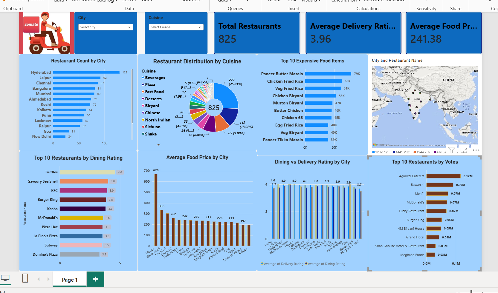

# 🍽️ Zomato Restaurant Analytics Dashboard

An end-to-end Data Analytics project using **SQL, PostgreSQL, Power BI, and CSV datasets** to analyze restaurant data and generate meaningful business insights.

---

## 📌 Project Overview

The Zomato Restaurant Analytics project focuses on analyzing restaurant data to understand restaurant distribution, cuisine popularity, customer ratings, food prices, and customer votes.

An interactive Power BI dashboard presents the analysis through KPI cards, charts, maps, and filters.

## 🎯 Project Objectives

* Analyze restaurant distribution across cities.
* Compare dining and delivery ratings.
* Identify popular cuisines and food items.
* Analyze food prices across cities.
* Identify highly rated restaurants.
* Analyze restaurant votes and popularity.
* Build an interactive Power BI dashboard.
* Generate meaningful business insights using SQL.

## 🛠️ Tools & Technologies

| Tool       | Purpose                                 |
| ---------- | --------------------------------------- |
| SQL        | Data querying and analysis              |
| PostgreSQL | Database management                     |
| Power BI   | Interactive dashboard and visualization |
| CSV        | Dataset storage and data preparation    |
| GitHub     | Project hosting and version control     |

## 📊 Dashboard Preview

## 📈 Key Performance Indicators

* **Total Restaurants**
* **Average Delivery Rating**
* **Average Food Price**

## 📉 Dashboard Features

The dashboard includes the following visualizations:

1. Restaurant Count by City
2. Restaurant Distribution by Cuisine
3. Top 10 Expensive Food Items
4. Top 10 Restaurants by Dining Rating
5. Average Food Price by City
6. Dining vs. Delivery Ratings by City
7. Top 10 Restaurants by Votes
8. Restaurant Locations Across Cities

### 🔎 Interactive Filters

* City
* Cuisine

These filters help users explore the restaurant data according to their selecte
